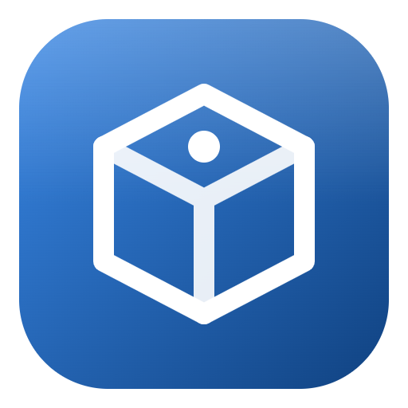

# Rain盒子 · Rainbox

**硬件状态、游戏设置与常用工具，一个盒子就够了。**

为 Windows 10 / 11 x64 打造的桌面工具箱，让查看硬件、调整游戏和管理日常工具更顺手。

### [↓ 下载 Rain盒子](https://github.com/11Rainen/Rainbox/releases/latest)

[版本记录](https://github.com/11Rainen/Rainbox/releases) · [问题反馈](https://github.com/11Rainen/Rainbox/issues) · [作者主页](https://github.com/11Rainen)

---

## 你的电脑，清楚掌握

| 功能 | 可以做什么 |
| :--- | :--- |
| 🖥️ **硬件概览** | 集中查看处理器、显卡、内存、存储、网络与主板信息，以及 BIOS 版本。 |
| 📊 **实时监控** | 查看受支持设备的温度、功耗、负载与风扇转速，快速了解运行状态。 |
| 🎮 **游戏配置** | 检测已识别的游戏配置，备份、调整画质并按需还原。 |
| 🎨 **ICC 滤镜** | 选择显示器、调整强度、导入导出 ICC，支持限时预览和原始曲线恢复。 |
| ⚡ **系统优化** | 集中管理系统优化、电源计划与常用工具；支持的修改保留原始设置用于还原。 |
| 🛍️ **应用商店** | 通过 Windows winget 安装常用应用，图标随 Rain盒子的主题呈现。 |
| 🫧 **自由外观** | 自定义壁纸、整窗磨砂透明，自动提取壁纸主色，并调节透明度与虚化。 |
| ⬆️ **软件更新** | 在应用中检查新版、下载安装包并校验 SHA256。 |

## 为常玩的游戏准备

| 游戏 | 正式版支持 |
| :--- | :--- |
| 英雄联盟 · 三角洲行动 · 无畏契约 · CS2 · PUBG | 已识别配置的检测、备份、画质调整与还原 |
| 永劫无间 | 游戏内设置建议 |

修改配置前请先退出游戏。仅处理已识别的配置格式，特殊路径可手动定位；永劫无间目前提供设置建议。

## 开始使用

1. 打开 **[最新版本下载页](https://github.com/11Rainen/Rainbox/releases/latest)**，在 Assets 中下载 `.exe` 安装程序。
2. 按提示完成安装。硬件读数与部分系统功能需要管理员权限。
3. 打开 Rain盒子，从概览查看硬件，再按需选择游戏配置、滤镜或系统工具。

已安装用户可覆盖升级，保留个人外观设置与已有备份。GitHub 下载速度取决于网络环境。

<strong>展开查看功能适用范围</strong>

- **硬件与主板：**读数和 BIOS 检查取决于设备支持情况。BIOS 更新目前仅覆盖部分厂商和型号，下载后请按主板厂商说明操作。
- **显示滤镜：**使用 SDR 校准曲线；HDR 开启或 HDR 状态无法确认时不启用。游戏、显卡驱动或系统可能覆盖显示效果。
- **优化与恢复：**按实际需求选择优化项，使用对应恢复入口还原支持的设置。不同硬件与系统环境下效果会有差异。

## 一起把 Rain盒子做得更好

遇到异常或有新想法，欢迎提交 **[Issue](https://github.com/11Rainen/Rainbox/issues)**。反馈时附上软件版本、Windows 版本、相关硬件型号、复现步骤和错误提示，方便定位问题。截图请隐藏序列号、账号等个人信息。

## 作者与著作权

**作者：十一月 · [@11Rainen](https://github.com/11Rainen)**

© 2026 十一月。Rain盒子的原创界面、文案与代码保留所有权利，请尊重作者署名，禁止冒名发布。本仓库用于官方安装包分发、版本说明、在线更新与反馈；公开分发不代表授予程序源码的开源许可。

第三方应用名称、图标和组件的商标及著作权归各自权利人所有，第三方组件遵循各自许可证。

感谢 [Pavise · bdth / dulaiduwang003](https://github.com/dulaiduwang003/Pavise-Game) 提供项目展示与游戏优化方向的启发。本页采用 Rain盒子的原创文案，未复制对方文案或项目素材；此致谢不代表合作或背书。

---

## ☕ 自愿支持

如果 Rain盒子帮到了你，欢迎点一颗 Star，或通过反馈参与完善。

感谢每一份支持，让 Rain盒子继续成长。

**十一月 · Rain盒子**

